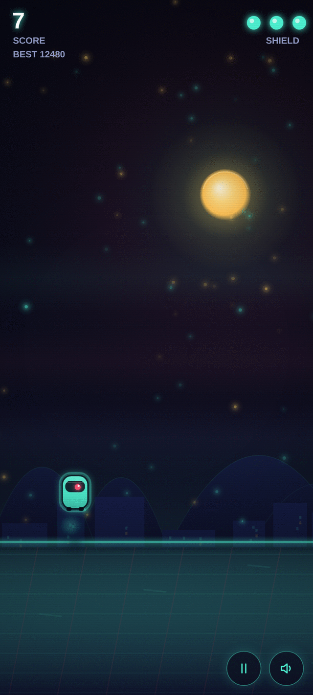
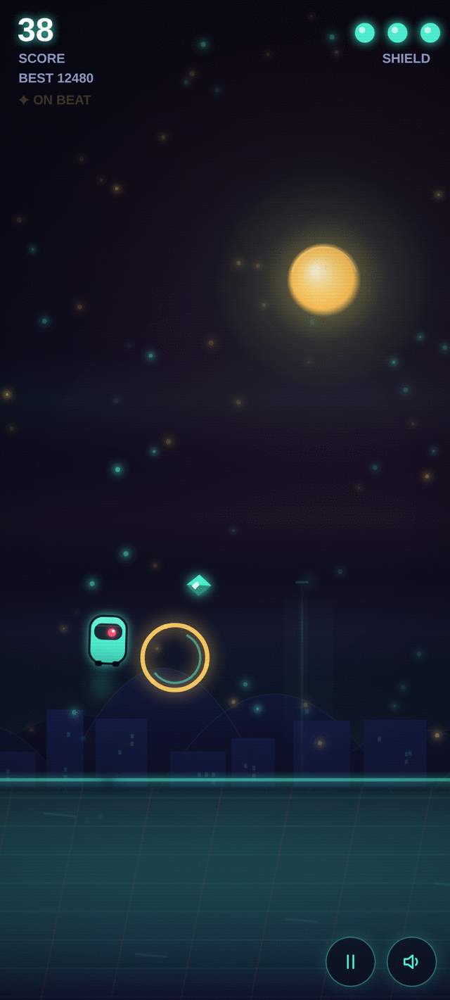

<div align="center">

&nbsp;&nbsp;

# VibeHop

**Tap. Hop. Vibe.**

A lo-fi neon rhythm runner that fits in a single HTML file — and in your pocket.
No installs required, no downloads, no dependencies. Just vibes.

[](https://bigknoxy.github.io/vibehopper/)

[](LICENSE)
[](#under-the-hood)
[](#install-it-like-an-app)
[](#under-the-hood)
[](#install-it-like-an-app)

</div>

---

## What is this?

You're a little neon runner in a night-lit city that scrolls to a 115 BPM lo-fi groove.
One button. Infinite vibes. Your shield has **three pips** — clip a wall and it shatters,
costing one pip and buying you 1.5 seconds of invincibility. Collect prism orbs to heal
and stack your multiplier up to **×5**, thread jump rings for a mid-air dash, and hop
**on the beat** for bonus points. Chase your best score deeper into the run.

It's the kind of game you finish a round of while the kettle boils — except you won't
stop at one round.

**▶ [Play it now](https://bigknoxy.github.io/vibehopper/)** — runs in any modern browser.

## How to play

| Action | Keyboard | Touch |
|---|---|---|
| Hop | `Space` / `↑` / `W` | Tap anywhere |
| Keep hopping | Hold the key | Hold your finger down |
| Dash | — | Tap **inside a glowing ring** |
| Pause | `P` / `Esc` | ⏸ button (bottom-right) |
| Mute | — | 🔊 button (bottom-right) |

- 🛡️ **3-pip shield** — collisions shatter the obstacle, cost 1 pip, and grant 1.5s of invulnerability.
- 🔮 **Prism orbs** — restore a pip **and** raise your multiplier (caps at ×5).
- ⭕ **Jump rings** — tap while inside one for a mid-air dash and bonus points.
- 🎵 **Play on the beat** — hop within a beat of the groove for a `✦ ON BEAT` bonus.
  (The first ring you meet teaches the dash; new players are never left guessing.)
- 🧠 **Forgiving by design** — 70% hitbox, 6-frame jump buffering, hold-to-auto-hop,
  spawn grace, and a variable-height jump (tap for a hop, hold for a full jump).

## Features

- 🎧 **Music that writes itself** — 115 BPM lo-fi loop and every sound effect synthesized live
  with the Web Audio API. Zero audio files.
- 🌌 **Neon-drenched canvas** — a baked starfield, feathered sun, layered ridges, a lit night
  city and glass pillars in parallax, plus particle bursts, screen shake and a colour flash
  when your shield takes a hit.
- 📐 **Right-sized on every screen** — phones play full-bleed; on a wide monitor the field is
  capped at a phone-like width so the difficulty stays honest, framed by a soft neon bezel.
- ⏸ **Respectful of real life** — on-screen pause and mute (both persist), auto-pause when
  you switch tabs, reduced-motion support, and a one-tap **Share** on the game-over screen.
- 🏆 **Chase moments** — a celebratory NEW BEST pop with your score delta, obstacles that
  land on the beat, and a speed curve that keeps climbing until 900 px/s.
- 📱 **Install it like an app** — Android gets an in-game install button; iOS gets a
  Share → Add to Home Screen tip and real PNG home-screen icons. Runs fullscreen, launches offline.
- 💾 **Best score persists** — and it only ever ratchets *up*.
- 🪶 **One HTML file** — the whole game is `index.html` (67KB, no build step). View source, learn, remix.

## Install it like an app

**Android (Chrome):** open the game → tap **⬇ INSTALL** in the top-right → confirm.
It lands on your home screen and opens fullscreen, even with no signal.

**iPhone / iPad (Safari):** open the game → tap **Share ⎋** → **Add to Home Screen**.
The in-game tip walks you through it.

## Under the hood

- Single-file game: canvas rendering, fixed-timestep (1/60) update loop, DPR-aware,
  with cached glow sprites and baked background layers so a full frame fits a 60fps budget.
- Audio: lookahead scheduler with `AudioContext` — kick, hat, snare, bass, pads and a
  pentatonic lead, quantized to an 8-bar Am7 → Dm7 → G7 → Cmaj7 progression.
- PWA: `manifest.json` (PNG + maskable icons, screenshots, `id`/`display_override`) + `sw.js`
  (network-first navigations with an offline cache fallback; cache version bumped automatically by
  `deploy.sh`, which also re-renders the icons from `docs/icon.svg` through headless Chrome).
- Social card: `docs/og.png` is composed by `tests/compose-og.js` from a real gameplay frame.
- Zero runtime dependencies. No fonts, no trackers, no CDNs — **0 external requests**
  (verified automatically, see below).

## Run it locally

```bash
git clone https://github.com/bigknoxy/vibehopper
cd vibehopper
python3 -m http.server 8080
# open http://localhost:8080
```

Or just run `./deploy.sh` — it deploys to GitHub Pages and starts the local server for you.

## Test & verify

Everything in `tests/` drives the real game in headless Chromium — no mocks, no fixtures.
There are two kinds of checks: **verification** (does it work?) and **falsifiers**
(we try to *break* every public claim; green means the claim survived), plus a
**regression** suite that pins every bug ever found so it can't come back.

```bash
cd tests && npm i
CHROME_BIN=/path/to/chrome npm run verify:live   # 11-check E2E against the deployed URL
CHROME_BIN=/path/to/chrome npm run features      # mute / pause / share / OG / a11y / stale-input
CHROME_BIN=/path/to/chrome npm run falsify       # invulnerability, buffering, hitbox, perf, offline…
CHROME_BIN=/path/to/chrome npm run regress       # one check per bug the code review found
CHROME_BIN=/path/to/chrome npm run shots         # refresh README screenshots from the live build
CHROME_BIN=/path/to/chrome npm run og            # recompose the social card (docs/og.png)
```

Current status — every suite green, locally and against the deployed URL:

| Suite | Checks | Result |
|---|---|---|
| `verify.js` (local E2E) | 8 | ✅ 8/8, 0 console errors |
| `features.js` | 7 | ✅ 7/7 |
| `falsifiers.js` | 11 | ✅ 11/11 |
| `regress.js` | 8 | ✅ 8/8 |
| `verify-live.js` (deployed) | 11 | ✅ 11/11, 0 external requests |

Bugs and lies this gauntlet has already caught (and fixed):

- 🐛 collisions could drain all three pips *inside* the invulnerability window → now one hit per window
- 🐛 jump buffering was half-wired: a mid-air press never triggered the landing hop → now it does
- 🐛 the death burst froze mid-air on the game-over screen → particles keep ageing
- 🐛 a tap on the iOS install tip leaked a phantom hop into the start of a run → input is cleared and captured per pointer
- 🐛 the app icons shipped as black plates (ImageMagick silently dropped the SVG gradients) → `deploy.sh` renders them through headless Chrome and asserts the colours
- 🐛 on a wide desktop window the game was measurably easier (viewport-relative spawns, four obstacles on screen) → the play field is capped
- 📉 **performance**: measured per-frame callback cost p95 **0.8 ms** (max 3.5 ms) in headless software
  rendering, and the fixed-step sim stays within **2–3%** of wall-clock time — reported by `falsifiers.js`

## Deploy your own

```bash
./deploy.sh
```

The script commits, creates the GitHub repo, enables GitHub Pages via the API and prints
your live URL. Idempotent — run it again any time you want to ship.

## License

MIT — do whatever, just vibe.

<div align="center">
<sub>Made with ⌨️ + 🌙 · no frameworks were harmed in the making of this game</sub>
</div>
